# Awesome-Business-Process-Management-BPM 🚀

  

  <strong>Curated Directory of Top Enterprise SaaS Platforms, BPMN 2.0 Engines, Workflow Orchestration &amp; Low-Code Automation Frameworks</strong> 
  <em>Everything you need to discover, model, automate, orchestrate, and optimize human-in-the-loop and microservice business workflows.</em>

---

## 📌 Table of Contents 📑

- [🌟 Sector Overview & Market Dynamics](#-sector-overview--market-dynamics)
- [🏢 Enterprise SaaS & Hosted Platforms](#-enterprise-saas--hosted-platforms)
- [💻 Open-Source GitHub Projects & Engines](#-open-source-github-projects--engines)
  - [⚙️ Open-Source Process Engines & Workflow Suites](#-open-source-process-engines--workflow-suites)
  - [🔀 Distributed Microservice & Data Workflow Orchestrators](#-distributed-microservice--data-workflow-orchestrators)
  - [🧩 Visual Process Modeling & BPMN Libraries](#-visual-process-modeling--bpmn-libraries)
- [🧭 Decision Matrix & Architectural Trade-offs](#-decision-matrix--architectural-trade-offs)
- [🤝 How to Contribute](#-how-to-contribute)
- [💖 Support](#-support)
- [📈 Star History](#-star-history)
- [⚠️ Disclaimer](#-disclaimer)

---

## 🌟 Sector Overview & Market Dynamics 📊

The global **Business Process Management (BPM)** and workflow automation market is valued between **$14.7B and $22.6B in 2025** (expanding rapidly from ~$10B–$19B in 2024), propelled by hyperautomation, cloud PaaS transitions, and AI-driven agentic process orchestration.

The competitive landscape is **moderately fragmented**:
* **Enterprise Heavyweights (Concentrated Core):** Dominant players such as **IBM**, **ServiceNow**, **Workday**, and **Pegasystems** anchor mission-critical operational processes within Fortune 500 ecosystems.
* **Agile Innovators & OSS Disruption (Fragmented Edges):** Open-source workflow frameworks, developer-first microservice orchestrators (such as Temporal and Camunda), and low-code/no-code platforms (such as n8n, Activepieces, and Kissflow) continuously challenge monolithic architectures, prompting steady industry consolidation.

---

## 🏢 Enterprise SaaS & Hosted Platforms ☁️

Curated enterprise SaaS solutions evaluated by company scale (valuation / annual revenue), starting tier costs, free tier/trial limits, and ideal use cases:

| Platform | Company Scale (Valuation / Revenue) | Starting Pricing Tier | Free Tier / Trial Limits | Description & Best For |
| :--- | :--- | :--- | :--- | :--- |
| **[IBM Business Process Manager / BAW](https://www.ibm.com/)** | ~$278B Market Cap (~$62B+ Rev) | £290.40–£373.20/user/year (~$30/user/mo via Cloud/G-Cloud; custom enterprise bundles) | 30-day free trial (hands-on cloud access to workflow authoring, decisions, and content services) | Enterprise BPM platform with formal process modeling, execution, and monitoring. Best for enterprises with existing IBM infrastructure requiring formal BPM governance and BPMN 2.0 export capabilities. |
| **[ServiceNow App Engine](https://www.servicenow.com/)** | ~$159B–$218B Market Cap (~$10B+ Rev) | ~$75–$120/creator user/month (Starter/Foundation tier; billed annually) | Free Personal Developer Instance (PDI) (1 active instance, non-production sandbox; hibernates upon inactivity; GenAI monthly prompt caps) | Low-code application development on the ServiceNow platform with ITSM & enterprise data integration. Best for organizations already on ServiceNow wanting custom workflow apps. |
| **[Workday Business Process Framework](https://www.workday.com/)** | ~$56B–$72B Market Cap (~$8.4B Rev) | ~$8–$42/employee/month ($96–$504/yr, min contract starts ~$100,000+/yr with core platform) | 30-day free trial available for Workday Adaptive Planning module upon request (no free trial for core HCM/Financials ERP) | Embedded business process engine within Workday HCM and Financials. Best for organizations already on Workday needing process automation tightly coupled to HR and finance transactions. |
| **[Pegasystems (Pega)](https://www.pega.com/)** | ~$3.1B–$3.5B Market Cap (~$1.4B Rev) | Quote-only case-based pricing (starting ~$90/user/mo or per-case completed fee) | 30-day free trial on Pega Community Edition (extendable once for +15 days up to 45 days total; 1 active cloud instance; auto-sleeps on inactivity) | Enterprise AI-powered workflow automation platform with MCP protocol support for third-party AI agents. Best for large enterprises deploying governed AI agents at scale. |
| **[Appian](https://appian.com/)** | ~$2.4B–$2.6B Market Cap (~$600M Rev) | Starts at $75/user/month (Standard tier; quote-only for advanced enterprise) | Free Community Edition (unlimited-time access for up to 15 users in shared dev environment; non-production; auto-pauses when idle) | Low-code automation platform combining BPM, case management, and AI. Best for enterprises wanting rapid low-code process application development with strong integration and case management. |
| **[Nintex](https://www.nintex.com/)** | ~$2.0B Valuation (~$250M+ ARR) | ~$1,250–$2,080/month ($15,000–$25,000/yr starting package based on usage/workflows) | 30-day free trial (no credit card required; access to Nintex Workflow, DocGen, and form builders under standard trial execution caps) | Workflow automation and process management platform with document generation and RPA. Best for organizations heavily invested in Microsoft/SharePoint ecosystems. |
| **[Camunda](https://camunda.com/)** | ~$1.0B+ Unicorn Valuation (~$150M–$200M ARR) | Enterprise SaaS starts at ~$4,160/month (~$50,000/year base commitment) | Permanent Free Modeling Tier (5 seats, unlimited BPMN/DMN design & collaboration) + 30-day full execution trial | Process orchestration platform with BPMN, DMN, and CMMN engines. Best for developer-centric teams wanting widely adopted open-core BPM engine with strong microservice orchestration. |
| **[Kissflow](https://kissflow.com/)** | ~$400M Implied Valuation (~$27M ARR) | Starts at $1,500–$2,500/month (Basic Plan, billed annually; unlimited internal creators) | 14-day guided trial available upon consultation with solutions team (no permanent free tier) | No-code/low-code workflow and process platform. Best for business teams wanting self-service process automation without developer involvement. |
| **[Bizagi](https://www.bizagi.com/)** | ~$145M Valuation (~$50M ARR) | Starts at ~$165/user/month (~$1,990/user/year base commercial pricing) | Permanently free Bizagi Modeler desktop app (individual BPMN 2.0 mapping/diagramming; local storage; no cloud automation engine) | Digital process automation platform with BPMN modeling and low-code app development. Best for organizations wanting strong BPMN modeling with a path to process automation. |
| **[ProcessMaker](https://www.processmaker.com/)** | Acquired by Decisions LLC (~$15M–$22M Rev) | Starts at ~$1,495/year (Standard entry tier; custom case-based pricing for advanced tiers) | 14-day to 30-day trial environment upon request through sales demo (no permanent free cloud tier; open-source core available) | Low-code BPM and workflow platform with process modeling, forms, and integrations. Best for mid-market organizations wanting a low-code BPM platform with flexible deployment options. |

---

## 💻 Open-Source GitHub Projects & Engines 🔓

Curated list of leading open-source BPM engines, workflow automation tools, and visual process designers, **sorted in descending order by GitHub stargazers count**. Each Stars_Badge links directly to the stargazers page of that repository.

### ⚙️ Open-Source Process Engines & Workflow Suites

- **[n8n](https://github.com/n8n-io/n8n)**  ⚡  
  **Fair-code workflow automation platform** with native AI agent orchestration, multi-step branching, and 400+ pre-built integrations.  
  *Tech stack*: TypeScript, Node.js, Vue.js. *License*: Sustainable Use License / Fair-code.  
  *Best for*: Technical teams building advanced multi-service automation flows with visual node editing and AI agent tooling.

- **[Activepieces](https://github.com/activepieces/activepieces)**  🤖  
  **Open-source no-code business workflow automation** tool designed as an extensible, privacy-first alternative to Zapier. Features an intuitive visual canvas, human approval steps, and community pieces.  
  *Tech stack*: TypeScript, Node.js, Angular. *License*: MIT.  
  *Best for*: Organizations needing self-hosted, MIT-licensed visual workflow automation with community-driven app connectors.

- **[Windmill](https://github.com/windmill-labs/windmill)**  🌪️  
  **Developer-first workflow engine and internal tool builder** that turns Python, TypeScript, Go, Bash, or SQL scripts into production-ready workflows, approval flows, and auto-generated UIs.  
  *Tech stack*: Rust, Svelte, Python, TypeScript. *License*: AGPL-3.0 / Apache 2.0 client.  
  *Best for*: Engineering and DevOps teams building high-performance asynchronous workflows and internal operational apps.

- **[Automatisch](https://github.com/automatisch/automatisch)**  🛡️  
  **Self-hosted business automation platform** built for data privacy and GDPR/HIPAA compliance. Enables connecting business applications without leaking customer data to third-party cloud brokers.  
  *Tech stack*: JavaScript, React, Node.js. *License*: AGPL-3.0.  
  *Best for*: Privacy-sensitive teams wanting a straightforward self-hosted workflow automation platform.

- **[Activiti](https://github.com/Activiti/Activiti)**  🏛️  
  **Battle-tested BPMN 2.0 execution engine** and the foundational root of modern open-source BPM. Offers lightweight embeddable execution, Spring integration, and REST APIs.  
  *Tech stack*: Java, Spring Boot. *License*: Apache 2.0.  
  *Best for*: Java teams maintaining legacy Activiti deployments or wanting a lightweight, unencumbered BPMN engine.

- **[Flowable](https://github.com/flowable/flowable-engine)**  🌊  
  **Cloud-native BPMN, CMMN, and DMN engine suite** and the leading enterprise-grade open-source BPM platform. Features separate embeddable engines, Docker/K8s readiness, and a comprehensive REST API.  
  *Tech stack*: Java, Spring Boot. *License*: Apache 2.0.  
  *Best for*: Modern microservice teams needing robust BPMN process orchestration, case management (CMMN), and business rules execution (DMN).

- **[Camunda 8 (Zeebe & Web Modeler)](https://github.com/camunda/camunda)**  🚀  
  **Distributed process orchestration platform** powered by the Zeebe event-driven workflow engine. Built for hyperscale microservice orchestration, human tasks, and enterprise BPMN 2.0 execution.  
  *Tech stack*: Java, Go, React. *License*: Camunda License / Source Available.  
  *Best for*: High-throughput distributed cloud architectures requiring microservice orchestration with strict visual BPMN observability.

- **[Camunda 7 Platform](https://github.com/camunda/camunda-bpm-platform)**  ☕  
  **Classic embeddable BPMN/DMN engine** widely adopted across enterprise Java ecosystems. Features Cockpit monitoring, Tasklist for human approvals, and deep Spring Framework bindings.  
  *Tech stack*: Java, Spring, REST. *License*: Apache 2.0 (Community Edition).  
  *Best for*: Teams running monolithic or microservice Java apps wanting a battle-tested embedded process engine.

- **[LiteFlow](https://github.com/dromara/liteflow)**  ⚡  
  **Ultra-lightweight rule-engine and business logic orchestrator**. Uses an expressive Expression Language (EL) to model complex conditional branching, parallel executions, and hot-reloadable rule chains inside applications.  
  *Tech stack*: Java, Spring Boot. *License*: Apache 2.0.  
  *Best for*: Developers orchestrating complex in-app business logic, risk scoring, and calculations without the weight of full BPMN engines.

- **[jBPM / Apache KIE](https://github.com/kiegroup/jbpm)**  🧠  
  **Comprehensive business automation suite** integrating BPMN 2.0 workflows with Drools business rule management (BRMS) and complex event processing (CEP). Currently migrating under the Apache KIE incubation umbrella.  
  *Tech stack*: Java, Drools. *License*: Apache 2.0.  
  *Best for*: Organizations with complex decision-making pipelines where business rules and compliance workflows are inextricably linked.

- **[ProcessMaker Community Edition](https://github.com/processmaker/processmaker)**  📋  
  **Full open-source BPM platform** offering visual drag-and-drop workflow modeling, interactive web forms, case management, and REST APIs.  
  *Tech stack*: PHP (Laravel), Vue.js, Docker. *License*: AGPL-3.0.  
  *Best for*: Teams seeking a complete web-based workflow portal with user task management in a LAMP/LEMP stack.

- **[Operaton](https://github.com/operaton/operaton)**  🔄  
  **Community-governed hard fork of Camunda 7**, created to ensure long-term, pure open-source (Apache 2.0) maintenance and evolution for embedded BPMN/DMN engines without vendor lock-in.  
  *Tech stack*: Java, Spring Boot. *License*: Apache 2.0.  
  *Best for*: Existing Camunda 7 users seeking an open-source, vendor-neutral drop-in upgrade path.

- **[Bonita Engine](https://github.com/bonitasoft/bonita-engine)**  🎨  
  **End-to-end digital process automation platform** combining visual process modeling (Bonita Studio), customizable user application pages (UI Designer), and an enterprise process runtime engine.  
  *Tech stack*: Java, Spring Boot, REST APIs. *License*: GPL-2.0.  
  *Best for*: Organizations bridging business analysts and developers to build complete, low-code workflow portals.

- **[CIB seven](https://github.com/cibseven/cibseven)**  🛡️  
  **Camunda 7 compatible open-source platform** offering continued enterprise support, bugfixes, and modern framework compatibility for existing BPMN 2.0 workflow estates.  
  *Tech stack*: Java, Spring Boot. *License*: Apache 2.0.  
  *Best for*: Enterprises seeking a drop-in Camunda 7 alternative with enterprise SLA and security patching.

---

### 🔀 Distributed Microservice & Data Workflow Orchestrators

These tools complement traditional BPMN engines by orchestrating high-throughput code-first workflows, microservices, and asynchronous event streams:

- **[Apache Airflow](https://github.com/apache/airflow)**  🌬️  
  **Programmatic workflow scheduling and batch processing platform**. Orchestrates tasks as Directed Acyclic Graphs (DAGs) in Python. Ideal for data engineering, ETL pipelines, and scheduled machine learning jobs. *(License: Apache 2.0)*.

- **[Conductor OSS](https://github.com/conductor-oss/conductor)**  🎼  
  **Microservices and AI agent orchestration engine** originally developed by Netflix. Provides stateful, resilient distributed execution with decoupled worker pools across languages. *(License: Apache 2.0)*.

- **[Kestra](https://github.com/kestra-io/kestra)**  ⚡  
  **Event-driven declarative orchestrator** using YAML to define complex pipelines, data workflows, and business integrations with real-time UI execution monitoring. *(License: Apache 2.0)*.

- **[Temporal](https://github.com/temporalio/temporal)**  ⏳  
  **Durable execution runtime** that guarantees workflows execute to completion despite infrastructure failures. Eliminates complex state machine code through code-first workflows in Go, Java, TypeScript, and Python. *(License: MIT)*.

---

### 🧩 Visual Process Modeling & BPMN Libraries

- **[bpmn-js (bpmn.io)](https://github.com/bpmn-io/bpmn-js)**  📐  
  **The definitive web-based BPMN 2.0 rendering and modeling library**. Written in JavaScript, it embeds interactive process diagrams directly inside any web application or custom low-code canvas. *(License: bpmn.io License / Source Available)*.

---

## 🧭 Decision Matrix & Architectural Trade-offs ⚖️

When selecting a workflow or BPM system, selecting the right architecture is critical:

1. **BPM Engines (Flowable, Camunda 7/Operaton, Activiti):**  
   *Structure*: Embeddable libraries or standalone REST daemons.  
   *Focus*: Formal BPMN 2.0 compliance, human user tasks, multi-step approvals, and decision tables (DMN).  
   *Trade-off*: Developers must design and build the front-end user experience and forms.

2. **Full BPM Suites (Bonita, ProcessMaker):**  
   *Structure*: Complete packaged web applications with studios, form builders, and administrative dashboards.  
   *Focus*: Citizen developers and business analysts collaborating directly on end-to-end apps.  
   *Trade-off*: Heavier application footprints and less architectural flexibility.

3. **No-Code / Low-Code Integration Platforms (n8n, Activepieces, Automatisch):**  
   *Structure*: Event-driven connectors and visual node canvases.  
   *Focus*: Rapid API integrations, cross-app data routing, and AI agent steps.  
   *Trade-off*: Not designed for formal BPMN 2.0 XML specifications or enterprise CMMN case management.

4. **Durable Code-First Orchestrators (Temporal, Conductor OSS):**  
   *Structure*: Scalable worker fleets executing code routines with guaranteed persistence.  
   *Focus*: Microservice transactions, distributed sagas, and cloud infrastructure pipelines.  
   *Trade-off*: No native visual BPMN diagramming or built-in human task approval portals.

---

## 🤝 How to Contribute 💡

We welcome contributions from the global automation community! Follow these steps to submit additions or improvements:

1. 🍴 **Fork** this repository.
2. 🌿 **Create a branch** for your updates (`git checkout -b add-process-tool`).
3. ✏️ **Edit `README.md`**: Follow the established table or open-source list format, including social Stars_Badges, tags, and accurate license information.
4. 🚀 **Commit & Push** your changes cleanly.
5. 📬 **Submit a Pull Request** with a concise summary of the added tool and why it benefits developers.

---

## 💖 Support ☕

Thank you for exploring this curated guide to Business Process Management and workflow automation!

If you find this repository valuable, please consider:
- ⭐ **Starring** the repository on GitHub
- 🍴 **Forking** and sharing with colleagues, DevOps, and process engineering teams
- ☕ **Buying a coffee or becoming a sponsor** to support ongoing updates and maintenance via the **[GitHub Sponsors Dashboard](https://github.com/sponsors/ishandutta2007)**.

Your support helps keep this directory up-to-date, transparent, and independent!

---

## 📈 Star History 📊

---

## ⚠️ Disclaimer 📜

- This repository is an independently curated educational resource and does not constitute formal legal, commercial, or technical endorsement of any vendor.
- Organizations deploying BPM software handling sensitive, regulated, or personal customer data must verify compliance with regional standards (e.g., GDPR, HIPAA, SOC 2, ISO 27001) and enforce strict access control and auditing.
- Commercial vendor pricing is subject to custom scoping, volume licensing, and change over time. Verify quotes directly with official sales representatives.

---

  Built with ❤️ for developers, software architects, and business workflow teams worldwide.

